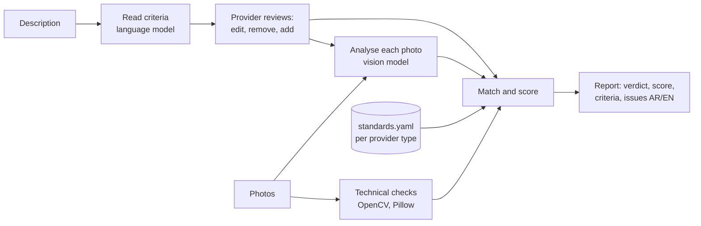

# Saudi Partner Listing Validator

Checks a tourism listing's photos **against its own description**, and against a photo standard for each provider type, before the listing goes to content approval.

Providers write descriptions in their own words, so there is no fixed checklist. The check **reads the description into criteria** (what the photos must show), lets the provider **edit, remove or add** criteria, and then checks every photo against them. "رحلة غطس" (a diving trip) needs a photo of diving; a provider can add "a boat" and the check will look for one.

If the description says *swimming pool*, a photo must show a pool. If it offers *a bedroom with a king bed and a private bathroom*, there must be a bedroom photo and a bathroom photo. A café that serves *fresh salads* shouldn't show a steak, and a *t-shirt* store shouldn't show a coffee cup. Every photo is also checked for resolution (below HD, HD, Full HD, 4K), sharpness, exposure, overlays, collages and duplicates.

This is a prototype for the Saudi Tourism Authority's Saudi Partner platform (TXLoad). The page uses TXLoad's look, in Arabic and English.

| | |
|---|---|
| Provider types | Activities · Accommodation · Food & Beverages · Shopping |
| Languages | Descriptions and feedback in Arabic and English |
| Vision model | Claude (Anthropic) by default, behind one adapter so it can be replaced |
| Local checks | Resolution tier, file size, orientation, sharpness, exposure, colour, duplicates |
| Criteria | Read from any description, Arabic or English; editable by the provider before the check |
| Output | Verdict (Ready / Needs changes / Partly checked), score out of 100, criterion-by-criterion coverage, per-photo issues, bilingual fixes, JSON |

## Try it in two minutes

You need Python 3.12 or newer (tested on 3.12, 3.13 and 3.14), or Docker.

```bash
git clone https://github.com/jwaeidalajmi-hue/saudi-partner-listing-validator.git
cd saudi-partner-listing-validator
cp .env.example .env          # add your ANTHROPIC_API_KEY for the real check
pip install -r requirements.txt
uvicorn app.main:app --reload
```

Open <http://localhost:8000>, write a description (or pick a **sample listing**), review the criteria under it, add photos and press **Check listing**.

With Docker:

```bash
cp .env.example .env
docker compose up --build
```

### No API key?

Leave `ANTHROPIC_API_KEY` empty (or set `VISION_PROVIDER=mock`). The app then runs in **demo mode**, and the page says so. Demo mode **cannot see photos**: criteria come from a small keyword list (or the first phrase of the description), and a photo's content is guessed from its **file name** (`pool.jpg`, `bathroom-2.png`, `steak-plate.jpg`). A photo whose name says nothing, such as `IMG_2041.jpg`, is reported as **not checked**, never guessed. The technical checks (resolution, sharpness, light, duplicates) are real. Placeholder photos for each sample are in `samples/mock-photos/`. Use an API key to judge real photos.

To add the key in GitHub Codespaces: on GitHub, **Settings → Secrets and variables → Codespaces → New repository secret**, name `ANTHROPIC_API_KEY`. Restart the codespace, then run without `VISION_PROVIDER=mock`.

## How it works



1. **Criteria.** The language model reads whatever the provider wrote, however short or long, and lists what a photo could show. Each criterion is *must show* (what the listing is about) or *nice to have*, with what a matching photo would contain. The page shows them under the description as the provider types; the provider can edit, remove or add their own. If the description names nothing a photo can show, the provider type's usual photos are used instead.
2. **Technical checks.** These run locally on every photo: pixel size and tier, file size against TXLoad's 3 MB limit, orientation, sharpness (variance of the Laplacian), brightness and clipping, saturation, and a perceptual hash for duplicates.
3. **Vision.** Each photo is labelled with every scene it shows from its provider type's list (a diver over a reef is both *the activity* and *the place*). The model also lists the objects it sees and which criteria the photo shows or contradicts, judged by meaning in either language. It flags unrelated photos, overlays (watermark, logo, text, border), collages, screenshots, stock or AI-looking images, people, children and licence plates, and gives a quality score from 1 to 5.
4. **Match and score.** Plain rules in `app/matching.py` turn all of that into issues and a score out of 100: technical 30, criteria coverage 35, relevance 20, completeness 15 (enough photos, a first photo that shows a must-show criterion, suggested scenes). A listing is **Ready** at 80 or more with no blocking issue. If some photos couldn't be analysed, it is **Partly checked**: criteria are marked *not checked* rather than missing.

## The photo standard

What a listing must show comes from **its own description**, as the provider edited it. `app/standards.yaml` adds, for each provider type, the minimum number of photos, the scenes it can recognise, scenes to **suggest** (tips that never block), **fallback** scenes used only when a description names nothing a photo can show, and `always_required` for any scene STA decides every listing of a type must show (empty by default). STA can change it without touching code; every report records the standard's version.

| Provider type | Minimum | Suggested (never block) | Fallback when the description names nothing visual |
|---|---|---|---|
| Activities | 4 | guests taking part, location, guide, equipment | activity in progress, location |
| Accommodation | 5 | exterior, bedroom, bathroom, living area, view | exterior, bedroom, bathroom |
| Food & Beverages | 4 | a dish, dining area, entrance, a drink | dining area, a dish, entrance |
| Shopping | 3 | product close-up, range, store front, interior | product close-up, product range |

| Check | Blocks | Warns |
|---|---|---|
| Resolution | below 1280×720 | HD below 1920×1080 |
| File size | over 3 MB | |
| Sharpness | under 50 | 50 to 100 |
| Exposure | | mean brightness outside 50 to 215, or over 5% clipped |
| Overlays, collage, screenshot | yes | |
| Unrelated or contradicts the description | yes | |
| Duplicates | exact | near (hash distance 6 or less) |
| Must-show criterion without a photo | yes | |
| Nice-to-have criterion without a photo | | yes |
| Too few photos | yes | |
| First photo doesn't show a must-show criterion | | yes |
| Stock or AI-looking, people, children, licence plates | | yes |

## API

`POST /api/criteria` (form: `provider_type`, `description`) returns the criteria read from the description, for the provider to review. `from_standard` is true when the description named nothing visual and the provider type's fallback scenes are used.

`POST /api/validate` (multipart form)

| Field | |
|---|---|
| `provider_type` | `activities`, `accommodation`, `fnb` or `shopping` |
| `description` | The listing description, Arabic or English |
| `criteria` | Optional. JSON list of criteria as the provider edited them: the items from `/api/criteria`, or plain text such as `["قارب", "coral reef"]`. Omit it to read them from the description |
| `photos` | One or more JPEG, PNG or WebP files, in display order; the first is the cover |

```bash
curl -F provider_type=shopping \
     -F "description=A store selling printed cotton t-shirts." \
     -F photos=@samples/mock-photos/tshirt-rack.jpg \
     -F photos=@samples/mock-photos/coffee-cup.jpg \
     http://localhost:8000/api/validate

curl -F provider_type=activities -F "description=رحلة غطس" \
     -F 'criteria=["الغطس", "قارب"]' \
     -F photos=@samples/mock-photos/snorkel-reef.jpg \
     -F photos=@samples/mock-photos/boat-deck.jpg \
     http://localhost:8000/api/validate
```

The response is a `ListingReport` (see `app/models.py`) with `verdict`, `score`, `breakdown`, `claims` (each criterion with `status`: shown, missing or unchecked, and `photos`), `rules` (enough photos, first photo), `suggested`, `photos` (technical measurements, analysis with `scenes`, `checked`, issues) and `issues` with `message_en` and `message_ar`. Interactive docs are at `/docs`.

Also: `GET /api/standards` (the standard in use) and `GET /api/health`.

## Configuration

| Variable | Default | |
|---|---|---|
| `VISION_PROVIDER` | `anthropic` if a key is set, else `mock` | Which model adapter to use |
| `ANTHROPIC_API_KEY` | | Needed for `anthropic` |
| `ANTHROPIC_MODEL` | `claude-sonnet-5-5` | Any Claude model with vision |
| `MAX_PHOTOS` | `20` | Per listing |
| `MAX_UPLOAD_MB` | `15` | Hard cap per file for the API (the 3 MB TXLoad limit is a check, not a rejection) |
| `VISION_CONCURRENCY` | `4` | Photos analysed in parallel |
| `LOGIN_USERS` | | `name:password` pairs, comma-separated. When set, every page and API call needs a sign-in (see below) |

### Sign-in

To share the page with invited testers only, set `LOGIN_USERS`, for example `tester1:first-password,tester2:second-password`. In Codespaces add it under **Settings → Secrets and variables → Codespaces** as a repository secret, then stop and start the codespace so it reads it. Everyone then sees a sign-in page (Arabic or English) first; a sign-in lasts 12 hours and the page has a **Sign out** button. Names ignore upper/lower case; a password may contain `:` but not `,`. Ten wrong attempts from one address lock it out for 10 minutes. Changing the list signs everyone out. `/api/health` and the logo files stay open. Leave `LOGIN_USERS` unset for no sign-in (local runs, tests, CI). The code is `app/auth.py`.

## Use another model

Write a class with `extract_claims` and `analyze_image` (see `app/providers/base.py`) and return it from `app/providers/__init__.py`. For example, a self-hosted setup could use an open scene classifier, an object detector and OCR for overlays. The rules, report and page stay the same.

## Tests

```bash
VISION_PROVIDER=mock pytest -q
```

The tests cover the technical measurements, the matching rules, the four examples from the brief end to end through the API (a pool, a bedroom and bathroom, a salad against a steak, t-shirts against a coffee cup), and description-driven criteria: a two-word Arabic description, provider-edited criteria, one photo meeting several scenes, photos the demo cannot see, and the fallback when a description names nothing visual.

## Privacy

Photos and the description are sent to the configured model for the check. The service stores nothing; the caller keeps the report. Photos with identifiable people, children or licence plates are flagged for consent. Before using real provider content, confirm with STA data governance which model environment is approved.

## Project layout

```
app/
  main.py              HTTP API and the demo page
  pipeline.py          one listing in, one report out
  criteria.py          criteria from the description, the provider's edits, the fallback
  technical.py         local checks (OpenCV, Pillow, imagehash)
  matching.py          rules, score and verdict
  messages.py          every issue in English and Arabic
  standards.yaml       the photo standard per provider type
  providers/           model adapters: Claude, mock
web/                   the TXLoad-style page (plain HTML, CSS, JS)
samples/mock-photos/   placeholder photos for mock mode
tests/                 pytest
docs/                  product requirements and design notes
```

## Licence

To be chosen by the Saudi Tourism Authority before publishing. The Saudi Partner name, logo and banner belong to the Saudi Tourism Authority.
