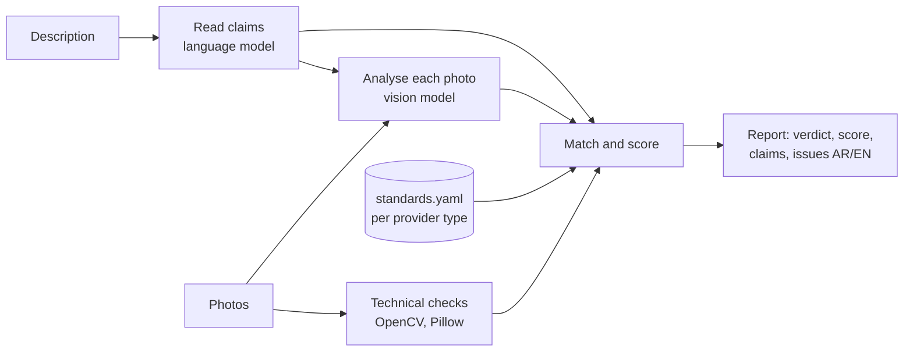

# Saudi Partner Listing Validator

Checks a tourism listing's photos **against its own description**, and against a photo standard for each provider type, before the listing goes to content approval.

If the description says *swimming pool*, a photo must show a pool. If it offers *a bedroom with a king bed and a private bathroom*, there must be a bedroom photo and a bathroom photo. A café that serves *fresh salads* shouldn't show a steak, and a *t-shirt* store shouldn't show a coffee cup. Every photo is also checked for resolution (below HD, HD, Full HD, 4K), sharpness, exposure, overlays, collages and duplicates.

This is a prototype for the Saudi Tourism Authority's Saudi Partner platform (TXLoad). The page uses TXLoad's look, in Arabic and English.

| | |
|---|---|
| Provider types | Activities · Accommodation · Food & Beverages · Shopping |
| Languages | Descriptions and feedback in Arabic and English |
| Vision model | Claude (Anthropic) by default, behind one adapter so it can be replaced |
| Local checks | Resolution tier, file size, orientation, sharpness, exposure, colour, duplicates |
| Output | Verdict (Ready / Needs changes), score out of 100, claim-by-claim coverage, per-photo issues, bilingual fixes, JSON |

## Try it in two minutes

You need Python 3.11 or newer, or Docker.

```bash
git clone https://github.com/<your-org>/saudi-partner-listing-validator.git
cd saudi-partner-listing-validator
cp .env.example .env          # add your ANTHROPIC_API_KEY for the real check
pip install -r requirements.txt
uvicorn app.main:app --reload
```

Open <http://localhost:8000>, pick a **sample listing**, add photos and press **Check listing**.

With Docker:

```bash
cp .env.example .env
docker compose up --build
```

### No API key?

Leave `ANTHROPIC_API_KEY` empty (or set `VISION_PROVIDER=mock`). The app then runs in **mock mode**. It is not computer vision: claims come from a small keyword list, and a photo's content is guessed from its **file name** (`pool.jpg`, `bathroom-2.png`, `steak-plate.jpg`). The local technical checks are real. Placeholder photos for each sample are in `samples/mock-photos/`. Use real photos with an API key to judge actual listings.

## How it works



1. **Claims.** The language model lists what the description says that a photo can show, marks each claim *core* (what the listing is about) or *extra*, and maps it to a scene.
2. **Technical checks.** These run locally on every photo: pixel size and tier, file size against TXLoad's 3 MB limit, orientation, sharpness (variance of the Laplacian), brightness and clipping, saturation, and a perceptual hash for duplicates.
3. **Vision.** Each photo is labelled with a scene from its provider type's list. The model also lists the objects it sees and which claims the photo supports or contradicts. It flags unrelated photos, overlays (watermark, logo, text, border), collages, screenshots, stock or AI-looking images, people, children and licence plates, and gives a quality score from 1 to 5.
4. **Match and score.** Plain rules in `app/matching.py` turn all of that into issues and a score out of 100: technical 30, claim coverage 35, relevance 20, required photos and cover 15. A listing is **Ready** at 80 or more with no blocking issue.

## The photo standard

`app/standards.yaml` holds, for each provider type, the scene list, required photos, minimum number of photos, the scenes allowed as the first photo, and the shared thresholds. STA can change it without touching code; every report records the standard's version.

| Provider type | Required photos | Minimum | First photo |
|---|---|---|---|
| Activities | activity in progress, location | 4 | activity in progress or guests taking part |
| Accommodation | exterior, bedroom, bathroom (plus every room the description names) | 5 | exterior or bedroom |
| Food & Beverages | dining area, a dish, entrance | 4 | a dish or the dining area |
| Shopping | product close-up, product range | 3 | product range or store front |

| Check | Blocks | Warns |
|---|---|---|
| Resolution | below 1280×720 | HD below 1920×1080 |
| File size | over 3 MB | |
| Sharpness | under 50 | 50 to 100 |
| Exposure | | mean brightness outside 50 to 215, or over 5% clipped |
| Overlays, collage, screenshot | yes | |
| Unrelated or contradicts the description | yes | |
| Duplicates | exact | near (hash distance 6 or less) |
| Core claim without a photo | yes | |
| Extra claim without a photo | | yes |
| Required photo missing, too few photos | yes | |
| Stock or AI-looking, people, children, licence plates | | yes |

## API

`POST /api/validate` (multipart form)

| Field | |
|---|---|
| `provider_type` | `activities`, `accommodation`, `fnb` or `shopping` |
| `description` | The listing description, Arabic or English |
| `photos` | One or more JPEG, PNG or WebP files, in display order; the first is the cover |

```bash
curl -F provider_type=shopping \
     -F "description=A store selling printed cotton t-shirts." \
     -F photos=@samples/mock-photos/tshirt-rack.jpg \
     -F photos=@samples/mock-photos/coffee-cup.jpg \
     http://localhost:8000/api/validate
```

The response is a `ListingReport` (see `app/models.py`) with `verdict`, `score`, `breakdown`, `claims` (each with `shown` and `photos`), `required`, `photos` (technical measurements, analysis, issues) and `issues` with `message_en` and `message_ar`. Interactive docs are at `/docs`.

Also: `GET /api/standards` (the standard in use) and `GET /api/health`.

## Configuration

| Variable | Default | |
|---|---|---|
| `VISION_PROVIDER` | `anthropic` if a key is set, else `mock` | Which model adapter to use |
| `ANTHROPIC_API_KEY` | | Needed for `anthropic` |
| `ANTHROPIC_MODEL` | `claude-sonnet-5-5` | Any Claude model with vision |
| `MAX_PHOTOS` | `20` | Per listing |
| `MAX_UPLOAD_MB` | `15` | Hard cap per file for the API (the 3 MB TXLoad limit is a check, not a rejection) |
| `VISION_CONCURRENCY` | `4` | Photos analysed in parallel |

## Use another model

Write a class with `extract_claims` and `analyze_image` (see `app/providers/base.py`) and return it from `app/providers/__init__.py`. For example, a self-hosted setup could use an open scene classifier, an object detector and OCR for overlays. The rules, report and page stay the same.

## Tests

```bash
VISION_PROVIDER=mock pytest -q
```

The tests cover the technical measurements, the matching rules, and the four examples from the brief end to end through the API: a pool, a bedroom and bathroom, a salad against a steak, and t-shirts against a coffee cup.

## Privacy

Photos and the description are sent to the configured model for the check. The service stores nothing; the caller keeps the report. Photos with identifiable people, children or licence plates are flagged for consent. Before using real provider content, confirm with STA data governance which model environment is approved.

## Project layout

```
app/
  main.py              HTTP API and the demo page
  pipeline.py          one listing in, one report out
  technical.py         local checks (OpenCV, Pillow, imagehash)
  matching.py          rules, score and verdict
  messages.py          every issue in English and Arabic
  standards.yaml       the photo standard per provider type
  providers/           model adapters: Claude, mock
web/                   the TXLoad-style page (plain HTML, CSS, JS)
samples/mock-photos/   placeholder photos for mock mode
tests/                 pytest
docs/                  product requirements and design notes
```

## Licence

To be chosen by the Saudi Tourism Authority before publishing. The Saudi Partner name, logo and banner belong to the Saudi Tourism Authority.
