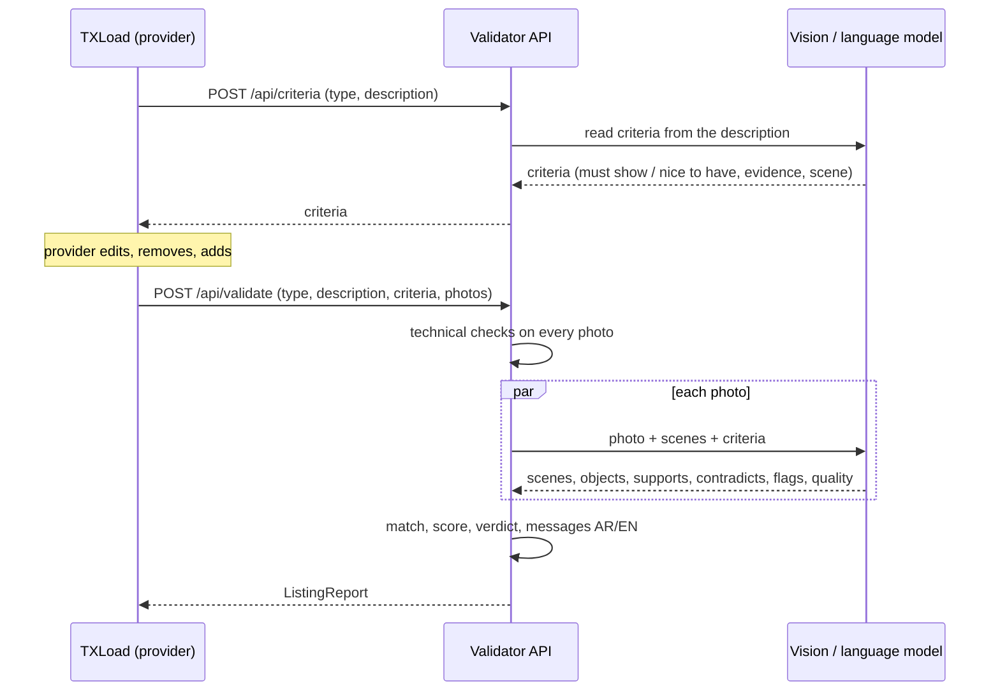

# Design notes

The full product requirements (problem, benchmark against Airbnb and GetYourGuide, rules, user stories, rollout, risks) live in STA's internal PRD: *PRD: AI Listing Photo Validation*. This folder keeps the parts engineers need next to the code.

## Decisions

| Decision | Why |
|---|---|
| What to check comes from the listing's own description, not a fixed list per provider type | Providers write freely; a fixed checklist rejects good listings ("no place photo" on a diving trip whose photos show the reef) and misses what the description promises |
| The provider can edit, remove and add criteria before the check | The provider knows the listing best; their edits are kept as `source = provider` so approvers can see them |
| Category scenes are suggestions; fallback only when the description names nothing visual | Keeps a floor for empty or non-visual descriptions without overriding what the provider wrote. STA can still force a scene per type with `always_required` |
| A photo can meet several scenes | One good photo often shows the activity and the place together |
| Photos the model could not analyse are "not checked", never "missing" | A wrong ✕ costs more trust than an honest "not checked"; the verdict is "Partly checked" |
| Rules live in code (`app/matching.py`), not in the model | Verdicts must be explainable and testable; the model only describes what it sees |
| The model returns structured JSON per photo | Every field in the report can be traced to one model answer or one measurement |
| Technical checks run locally | Resolution, sharpness and duplicates need no AI, cost nothing and keep working if the model is unavailable |
| A failed model call never fails the listing | The photo is reported as "not checked"; the technical checks still apply |
| One adapter for models | STA can switch to an approved or self-hosted model without touching TXLoad or the rules |
| Standard in YAML with a version | STA owns and tunes it; every report says which version it used |
| Warn first, block later | Blocking starts only after the shadow test shows 85%+ agreement with approvers and 90%+ precision |

## Flow

## Extending a provider type

1. Add or rename scenes under the provider type in `app/standards.yaml` (English and Arabic labels).
2. Adjust `suggested`, `fallback_required`, `always_required`, `cover`, `portrait_ok` and `min_photos`.
3. Bump `version`.
4. Run `pytest`; `app/standards.py` refuses a standard that names unknown scenes or drops the HD floor below 1024 pixels.
